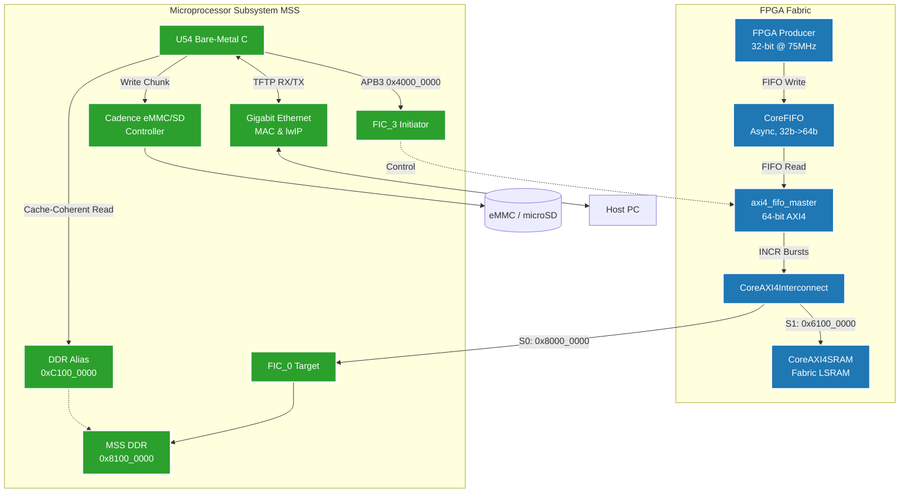
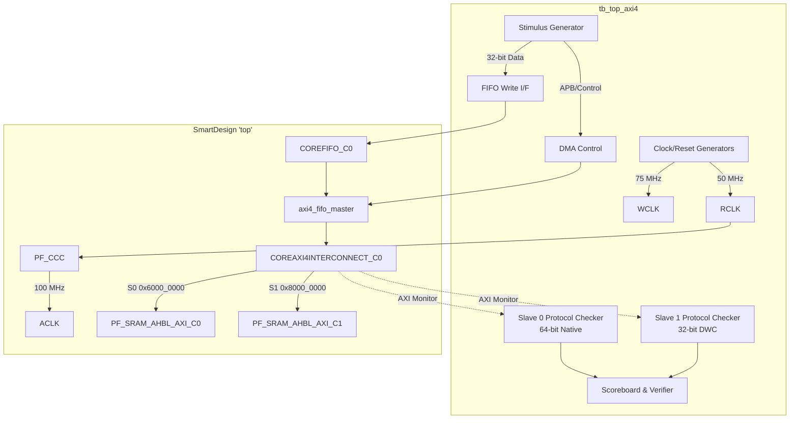

# PolarFire SoC FPGA-to-Storage Network Streaming Appliance

This project implements a complete, bare-metal hardware/software co-design for the Microchip PolarFire SoC (Icicle Kit and Discovery Kit). It demonstrates how to capture high-speed data generated in the FPGA fabric, stream it into MSS DDR or Fabric LSRAM via a custom AXI4 DMA master, commit it to raw eMMC/SD storage, and serve it directly to a host PC over Gigabit Ethernet via TFTP.

## 1. System Architecture

The design is split across the FPGA Fabric (Verilog/SmartDesign) and the Microprocessor Subsystem (MSS) running bare-metal C on the RISC-V U54 Application Hart.

### Hardware Data Path (FPGA Fabric)

1. **FPGA Producer (32-bit):** Custom FPGA logic generates 32-bit data words at 75 MHz.
2. **Clock Domain Crossing & Packing:** Data is pushed into a `CoreFIFO` (Asynchronous, Standard Read Mode) which seamlessly crosses the clock domain to the 100 MHz AXI clock and packs two 32-bit writes into a 64-bit read word.
3. **AXI4 DMA Master (`axi4_fifo_master.v`):** A custom HDL+ IP core reads the 64-bit FIFO and issues 4KB-boundary-compliant AXI4 `INCR` bursts to `CoreAXI4Interconnect`.
4. **Target Memory:** The DMA writes directly into either **MSS DDR** (via `FIC_0` @ `0x8100_0000`) or **Fabric LSRAM** (via `CoreAXI4SRAM` @ `0x6100_0000`).

### Software Data Path (MSS Bare-Metal Firmware)

1. **DMA Control (`fabric_dma.c`):** The U54 processor arms the AXI4 DMA master over APB3 (via `FIC_3`).
2. **Cache-Coherent Reads:** Once the DMA completes, the U54 reads the captured data from the **non-cached DDR alias** (`0xC100_0000`) to guarantee cache coherency without requiring manual L2 cache flushes.
3. **Storage Layer (`mmc_storage.c`):** The data is chunked into 512-byte LBAs and written to the onboard eMMC or microSD card.
4. **Network Serving (`tftp_server_app.c` & `net_port.c`):** An interrupt-safe lwIP Ethernet driver negotiates a DHCP/Static IP and serves the stored file to any connected host PC via TFTP.

### System Diagram



## 2. Hardware Support

| Feature | PolarFire SoC Icicle Kit | PolarFire SoC Discovery Kit | 
| ----- | ----- | ----- | 
| **Storage Media** | eMMC (8-bit, 200 MHz) + microSD Slot (`J22`) | microSD Slot only (`J10`) | 
| **Media Switching** | Dynamic runtime Bank 4 MSSIO muxing | Native microSD routing | 
| **Ethernet** | Dual Gigabit (GEM1/GEM0) | Single Gigabit (GEM0/GEM1 muxed) | 

## 3. Building the Project

### A. Generating the FPGA Bitstream (Libero SoC)

The hardware design is completely scripted using Libero SoC Tcl.

```bash
# Navigate to the FPGA design root
cd axi_interconnect_v7_mpf_wip

# Run the automated build script (Clean, Generate SmartDesign, Run Synthesis/Layout)
python3 build.py --family polarfire --clean
```

> **Expected Result:** Libero SoC will generate the `top` SmartDesign, synthesize it, and place-and-route the design. You should see `Info: Design Synthesis complete` and `Info: Generate Bitstream complete` in the terminal output.

### B. Compiling the Bare-Metal Firmware (Make)

```bash
# Navigate to the software project root
cd mpfs-netapp-emmc-sdcard

# Build for Icicle Kit (HSS DDR Release)
make BOARD=mpfs-icicle-kit clean ddr-release

# OR Build for Discovery Kit (HSS DDR Release)
make BOARD=mpfs-disco-kit clean ddr-release
```

> **Expected Result:** The compiler will generate the final payload binary.
> ```text
> [HSS] Generating boot payload: build/mpfs-icicle-kit/ddr-release/mpfs-net-app_payload.bin
> Hart Software Service formatted boot image generator
> ...
> Output filename is >>build/mpfs-icicle-kit/ddr-release/mpfs-net-app_payload.bin<<
> ```

## 4. Running the FPGA / AXI4 DMA Simulation

A comprehensive self-checking Verilog testbench (`tb_top_axi4.v`) is included. 

### Testbench Architecture



To run the automated ModelSim regression suite:
```bash
# Launch the Libero ModelSim simulation flow
python3 build.py --family polarfire --sim --clean
```

> **Expected Result:** ModelSim will launch in batch mode and print the scoreboard validation:
> ```text
> =================================================================
>    ASYNC COREFIFO (32b->64b) TO AXI4 MASTER REGRESSION SUITE     
> =================================================================
> [STATUS] Waiting for PF_CCC PLL lock and synchronized reset release...
> [STATUS] System ready (wclk=75 MHz, aclk=100 MHz). Starting sweeps.
> ...
> [FIFO-DMA SWEEP] Target: 0x60000000 | u64_Words: 4096 (32768 B) | Gap: 0 | ArmFirst: 0
>   [MATCH] Word 00000 | Addr: 0x60000000 | Data: 0xF1F0409600000000
>   [PASS] 4096 u64 words (32768 B) verified | Bursts: 256 | FULL stalls: 412
> ...
> =================================================================
>    ALL ASYNC FIFO-TO-AXI4 REGRESSION SWEEPS PASSED CLEANLY!      
> =================================================================
> ```

## 5. End-to-End Hardware Testing

### Step 1: Load Firmware via HSS

Connect your USB-UART cables and launch the interactive terminal:

```bash
# Terminal 1: HSS Console (typically /dev/ttyUSB0)
python3 mpfs-terminal.py /dev/ttyUSB0

# Terminal 2: Application Output (typically /dev/ttyUSB1)
python3 mpfs-terminal.py /dev/ttyUSB1
```

Reset the board, press a key in Terminal 1 to interrupt the HSS boot, and type `serialboot`. The script will automatically YMODEM transfer your compiled `.bin` payload into DDR and start the application.

> **Expected Result (Terminal 2):**
> ```text
> [INIT 1/4] SYSREG CLOCK_CR=0x...
> [INIT 2/4] Initializing eMMC / SD Storage...
> [MMC] eMMC initialized (200 MHz, 8-bit, sector=512 B)
> [INIT 3/4] Initializing Ethernet & lwIP Stack...
> [DHCP e0] Lease acquired!
> [NET e0] IP   : 192.168.20.52 | Mask: 255.255.255.0 | GW: 192.168.20.1
> [INIT 4/4] Starting HTTP (TCP/80) & TFTP-to-MMC (UDP/69) @ T+2540 ms...
> [APP] Ready. Press 'w' for local eMMC test or send a file via TFTP.
> ```

### Step 2: Trigger FPGA Capture

Press **`g`** in Terminal 2 to arm the AXI4 DMA and capture FPGA data.

> **Expected Result (Terminal 2):**
> ```text
> [FPGA-DMA] Armed 65536 B -> 0x81000000 (waiting for FIFO data)...
> [FIFO-FIC0] Capturing 65536 bytes into "fpga_cap.bin"...
> [MMC] Saved "fpga_cap.bin" to eMMC (65536 bytes, CRC32=0x8A7B6C5D)
> ```
*(Note: If the FPGA producer is not actively sending data, the DMA will time out safely after 2000 ms).*

### Step 3: Retrieve Data via TFTP

From your host PC, pull the captured FPGA data file out of the board's flash storage over Ethernet:

```bash
# Replace 192.168.20.52 with the IP address printed on your UART console
tftp -m octet 192.168.20.52 -c get fpga_cap.bin /tmp/fpga_cap.bin
```

> **Expected Result (Host PC Terminal):**
> ```text
> Transfer successful: 65536 bytes in 0.4 seconds, 163840 bytes/s
> ```
> Verify the file size on your host machine:
> ```bash
> ls -lh /tmp/fpga_cap.bin
> # Output: -rw-r--r-- 1 user group 64K Nov 20 12:00 /tmp/fpga_cap.bin
> ```