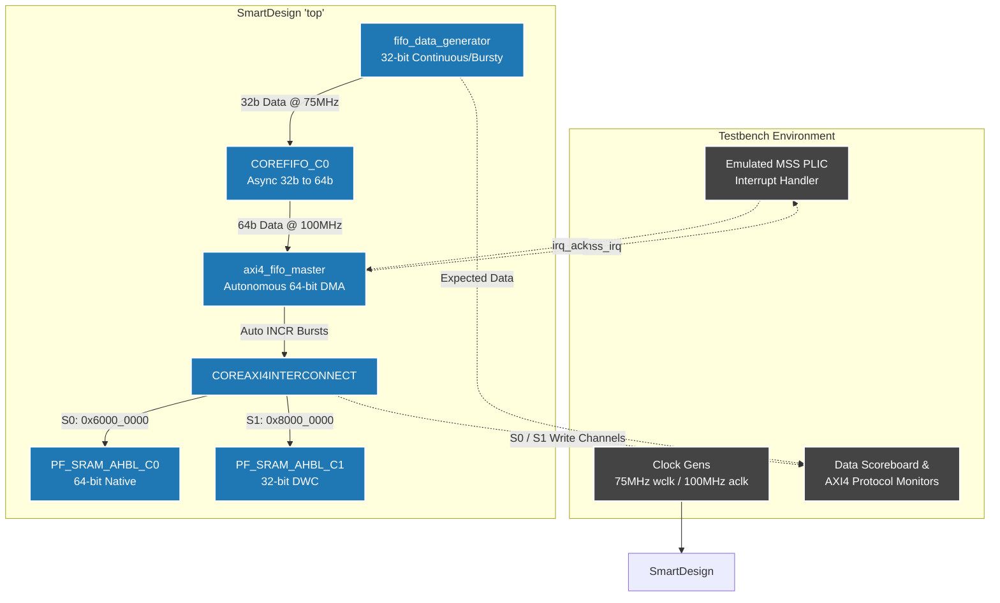

# Autonomous Async FIFO-to-AXI4 DMA Streaming

This project implements a fully autonomous, hardware-driven data streaming pipeline for the Microchip PolarFire SoC. It demonstrates high-speed asynchronous data capture from an FPGA producer, clock domain crossing, threshold-triggered AXI4 DMA bursts, and hardware interrupt generation—all verified via an automated Libero SoC and QuestaSim/ModelSim testbench.

> **Note:** This repository is currently configured for pure hardware simulation. Hardware testing and Microprocessor Subsystem (MSS) bare-metal C integration are bypassed in this flow.

---

## 1. System Architecture & Testbench

The design is contained entirely within the FPGA Fabric using Verilog and Libero SmartDesign (`top`). A comprehensive self-checking testbench (`tb_top_axi4.v`) drives the system, emulates the MSS interrupt controller, and validates AXI4 protocol compliance on the fly.

### Architecture Diagram



### Key Hardware Features Verified
1. **Clock Domain Crossing (CDC):** Asynchronous `COREFIFO` bridges a 75 MHz producer and a 100 MHz AXI4 fabric.
2. **Autonomous Threshold Bursting:** `axi4_fifo_master` wakes up and issues bursts immediately when `fifo_rdcnt` meets a configurable watermark.
3. **Producer Delay Handling:** An `idle_flush_cycles` timer detects slow or paused producers and forces a partial tail-burst so data is never stranded in the FIFO.
4. **Circular Ring Buffers:** Supports modulo wrapping over a programmable `buffer_size` to continuously stream into a fixed memory region.
5. **AXI4 4KB Compliance:** Hardware automatically splits bursts that would cross an AXI `0x1000` address boundary.
6. **Hardware Interrupts:** Generates level-sensitive interrupts (`mss_irq`) after transferring a specific `irq_chunk_bytes` threshold or upon an idle-flush completion.

---

## 2. Automated Simulation Flow

This project uses a custom Python build system (`build.py`) to wrap the Libero SoC Tcl API and ModelSim/QuestaSim execution.

### Prerequisites
- Microchip Libero SoC (in `$PATH` as `libero`).
- Siemens ModelSim / QuestaSim (in `$PATH` as `vsim`).
- Python 3.x.

### A. Fast Console Simulation (Batch Mode)
To compile the design from scratch, run a fast headless simulation, print the verification scoreboard, and save the waveform database (`vsim.wlf`):

```bash
python build.py --family polarfire --sim --clean --tb_top tb_top_axi4 --console
```

### B. Console Simulation + Auto-Open Waveform
To run the fast headless simulation and automatically open the recorded waveform in the GUI once finished:

```bash
python build.py --family polarfire --sim --clean --tb_top tb_top_axi4 --console --view_wave
```

### C. Live GUI Simulation
To compile the design and launch the QuestaSim interactive GUI with internal signal visibility (`+acc`) and predefined signal groups loaded via `wave.do`:

```bash
python build.py --family polarfire --sim --clean --tb_top tb_top_axi4 --gui
```

### D. Offline Waveform Viewer
If you have already run a `--console` simulation and want to inspect the results without recompiling:

```bash
python build.py --family polarfire --view_wave
```

---

## 3. Testbench Regression Phases & Expected Output

The `tb_top_axi4` environment runs through three continuous streaming phases. 

### Phase 1: Continuous Bursty Stream
The data generator pushes 32-bit words heavily, triggering normal 16-beat (128-byte) AXI4 bursts. Verifies continuous throughput, little-endian 32-to-64 bit packing, and standard periodic MSS interrupts.

### Phase 2: Intermittent Long Delays (Idle-Flush)
The data generator pauses for 300 cycles mid-stream. Verifies that the `idle_flush_cycles` timer detects the stall, drains the partial words out of the FIFO, commits them to AXI memory, and fires an early MSS interrupt.

### Phase 3: Circular Ring Wrap & Data Width Conversion
Streams data into the `0x8000_0000` slave. Verifies AXI4 downstream 64-to-32 bit Data Width Conversion (DWC) and checks that the `wr_offset` smoothly wraps back to `0` when hitting the 1024-byte circular buffer limit.

### Expected Console Output
When running the simulation, the console (or QuestaSim transcript) will output the following clean scoreboard report:

```text
=====================================================================
   AUTONOMOUS FIFO-TO-AXI4 STREAMING + MSS INTERRUPT REGRESSION      
=====================================================================
[STATUS] PLL Locked & Reset Released (wclk=75 MHz, aclk=100 MHz).

---------------------------------------------------------------------
 PHASE 1: CONTINUOUS BURSTY STREAM + MSS IRQ -> SLAVE 0 (0x6000_0000) 
---------------------------------------------------------------------
[PHASE 1] Written=2048 B | Gen_u32=535 | AXI_Bursts=16 | MSS_IRQs_Acked=4
  [PASS] All 256 64-bit words verified and 4 MSS interrupts serviced!

---------------------------------------------------------------------
 PHASE 2: INTERMITTENT LONG DELAY -> IDLE-FLUSH & MSS INTERRUPT      
---------------------------------------------------------------------
[PHASE 2] Flushed Partial Packets: Written=144 B | MSS_IRQs_Acked=3
  [PASS] Idle-flush timer drained partial bursts & fired MSS IRQ!

---------------------------------------------------------------------
 PHASE 3: CIRCULAR RING WRAP & BACKPRESSURE -> SLAVE 1 (0x8000_0000) 
---------------------------------------------------------------------
[PHASE 3] Ring Stream: Written=4480 B | wr_offset=384 | MSS_IRQs_Acked=17
  [PASS] Circular buffer wrapped cleanly modulo 1024 B with 17 MSS interrupts!

=====================================================================
   ALL AUTONOMOUS FIFO-TO-AXI4 + MSS INTERRUPT TESTS PASSED!         
=====================================================================
```